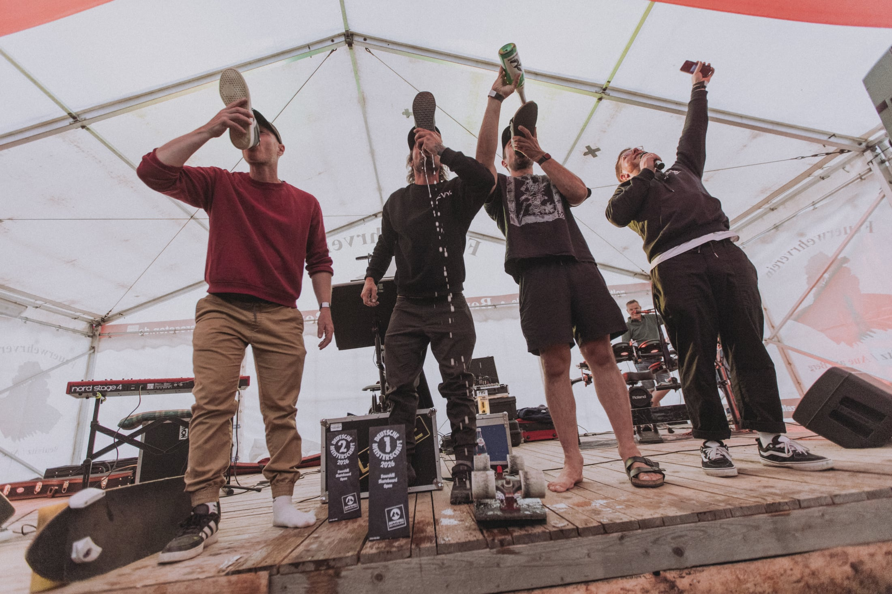
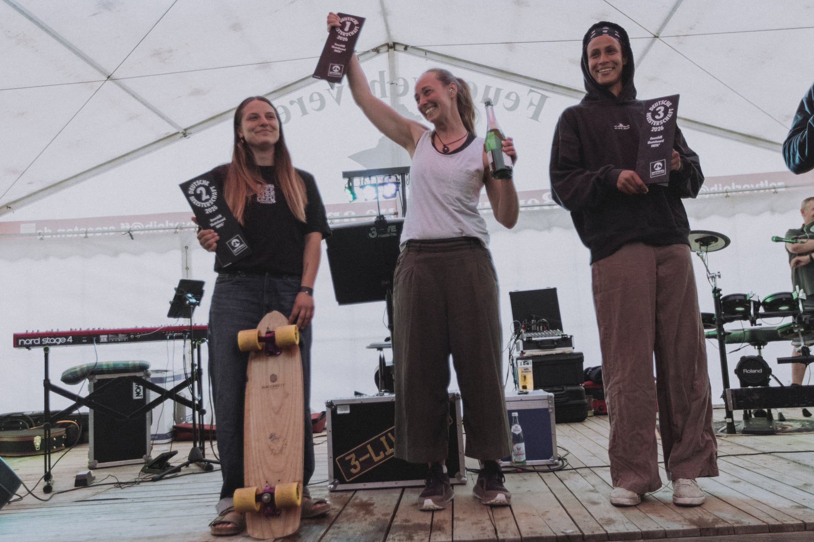
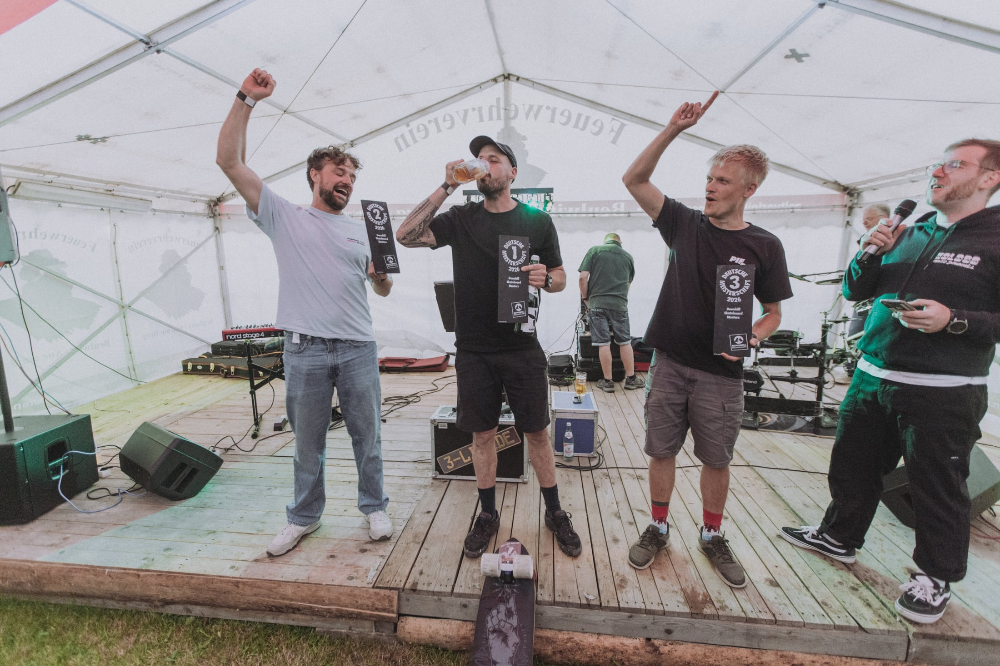
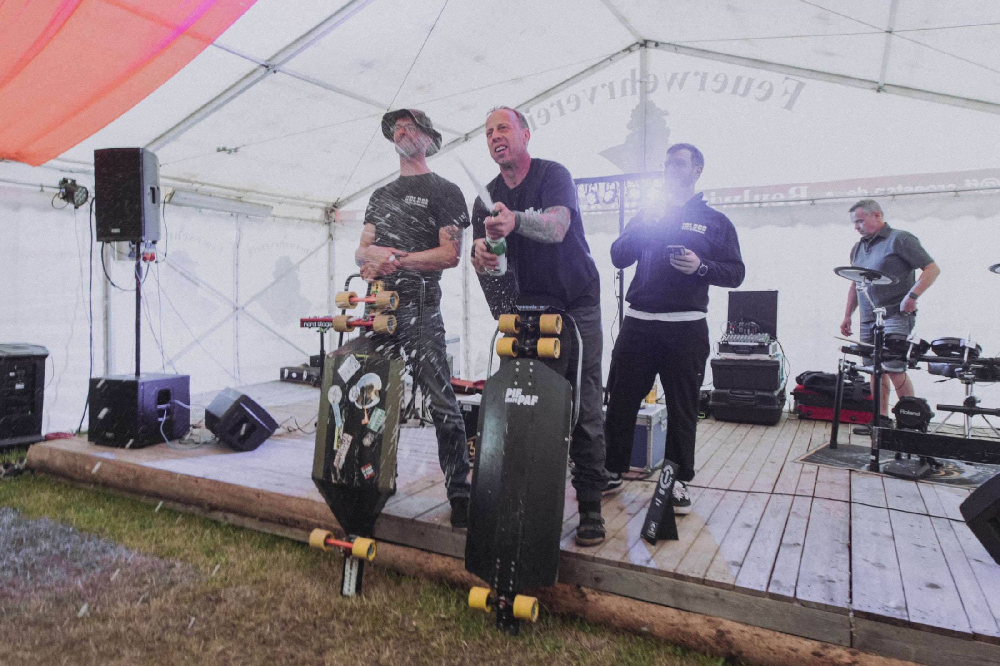

# German Downhill Skateboarding Championships – Season Recap

That’s a wrap on the German Downhill Skateboarding Championships! With the DOC Downhill Crew Teichfest DH Race, the season came to a close – and we now have this year’s German Champions.

This season consisted of two races: it kicked off with Rasen in Wasen near Freiburg, hosted by the Freiburg Freeride Crew – a smaller event with a lower points reward – before culminating in the Teichfest DH Race by the DOC Downhill Crew, where the titles were decided.

Here are your final championship podiums:

**OPEN** 🥇 Samuel Schuler 🥈 Gerrit Geiger 🥉 Alex Dehmel

**FINTA** 🥇 Marieke Wünsche 🥈 Hermine Meyer 🥉 Vivi Lewis

**MASTER** 🥇 Andi Mangold 🥈 Micha Benz 🥉 Michael Golawski

**LUGE** 🥇 Rainer Österle 🥈 Ed von Schleck 🥉 Peter Kamischke

We’re very happy with how the season went and want to thank the Freiburg Freeride Crew and the DOC Downhill Crew for organizing two fantastic races, as well as all racers, volunteers and spectators who made this season what it was. We’re already looking forward to 2026!

You can find the full results on [r4wrun.com](https://r4wrun.com/championships/deutsche-meisterschaft-dqL1CKqC).

Photos by Dasha.

* * *

## Deutsche Meisterschaft im Downhill Skateboarding – Saisonrückblick

Das war’s mit der Deutschen Meisterschaft im Downhill Skateboarding! Mit dem Teichfest DH Race der DOC Downhill Crew ging die Saison zu Ende – und die diesjährigen Deutschen Meister:innen stehen fest.

Die Saison bestand aus zwei Rennen: Los ging es mit Rasen in Wasen bei Freiburg, organisiert von der Freiburg Freeride Crew – ein kleineres Event mit geringerer Punktewertung – bevor beim Teichfest DH Race der DOC Downhill Crew das große Finale stieg und die Titel entschieden wurden.

Hier sind die finalen Podiums der Meisterschaft:

**OPEN** 🥇 Samuel Schuler 🥈 Gerrit Geiger 🥉 Alex Dehmel

**FINTA** 🥇 Marieke Wünsche 🥈 Hermine Meyer 🥉 Vivi Lewis

**MASTER** 🥇 Andi Mangold 🥈 Micha Benz 🥉 Michael Golawski

**LUGE** 🥇 Rainer Österle 🥈 Ed von Schleck 🥉 Peter Kamischke

Wir sind sehr zufrieden mit der Saison und bedanken uns bei der Freiburg Freeride Crew und der DOC Downhill Crew für zwei großartige Rennen – und natürlich bei allen Racern, Helfer:innen und Zuschauer:innen, die diese Saison zu dem gemacht haben, was sie war. Wir freuen uns schon auf 2026!

Die vollständigen Ergebnisse findet ihr auf [r4wrun.com](https://r4wrun.com/championships/deutsche-meisterschaft-dqL1CKqC).
