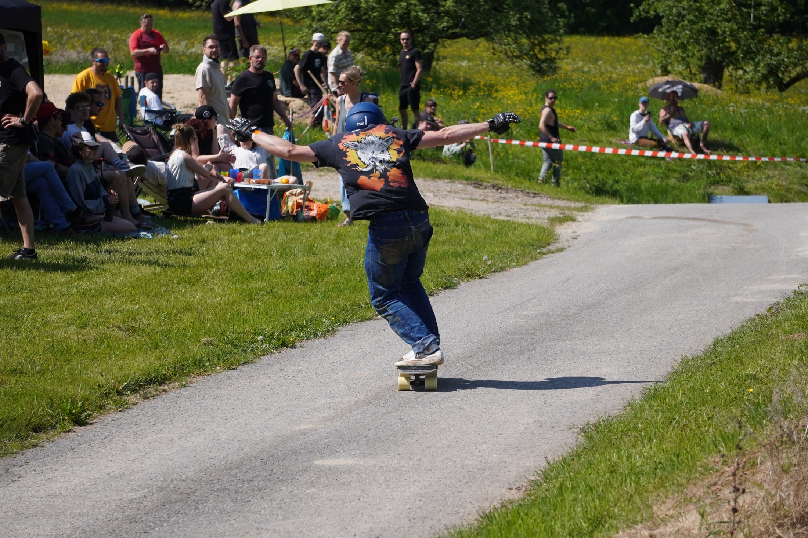
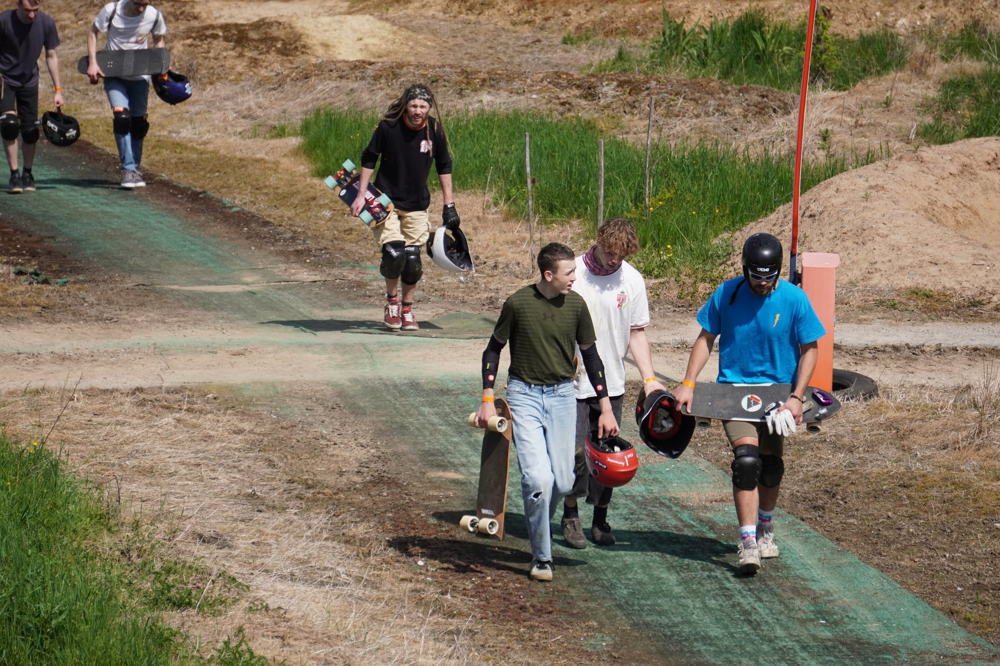
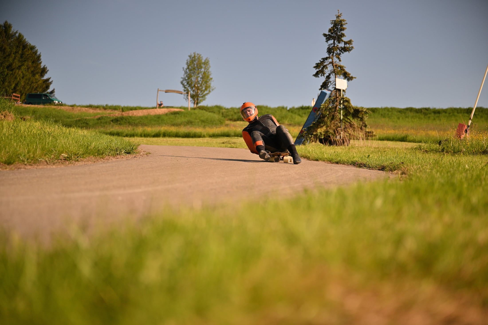
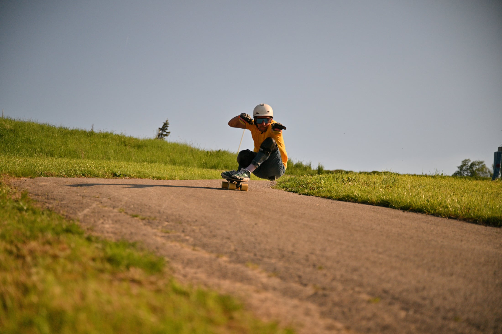
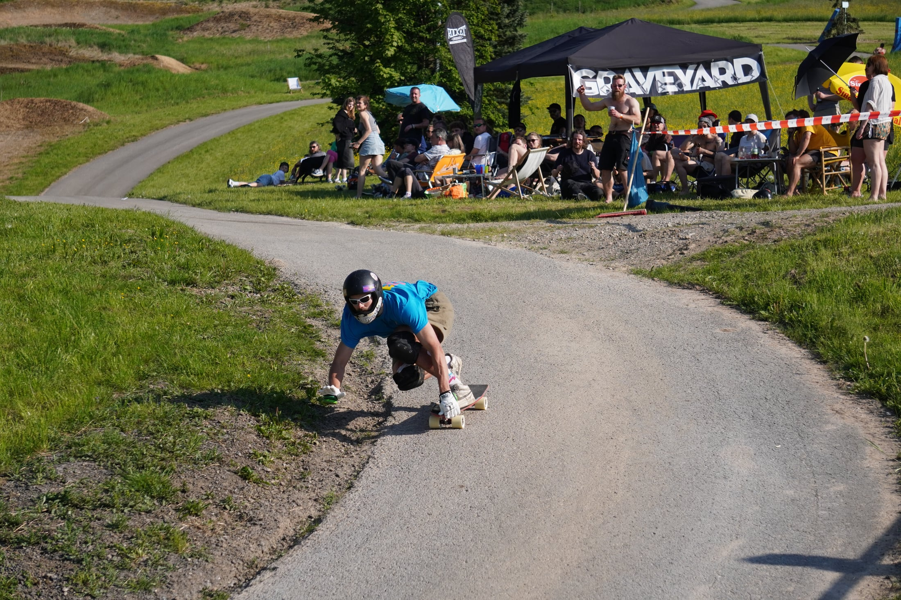
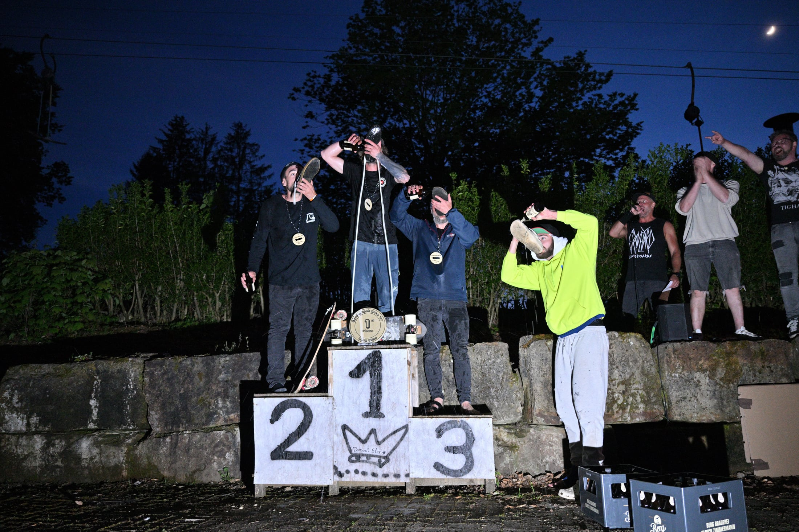
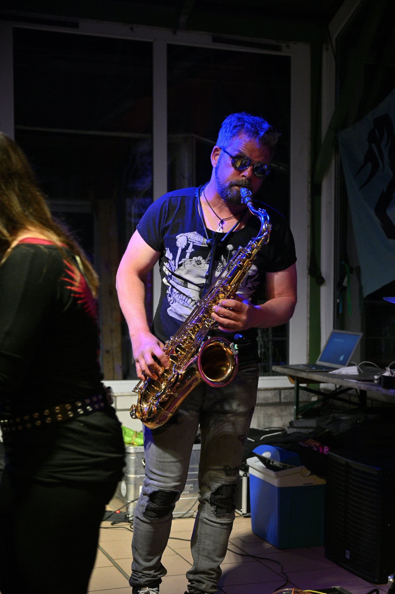
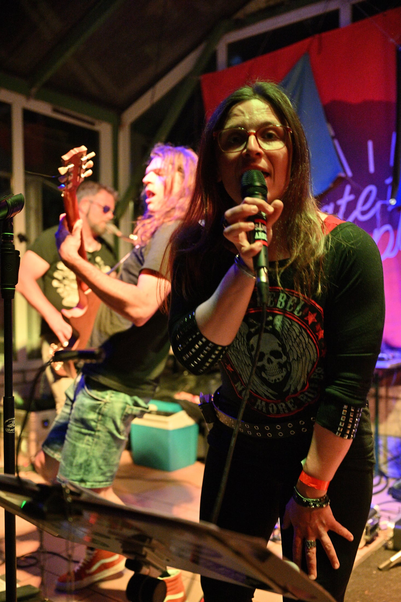
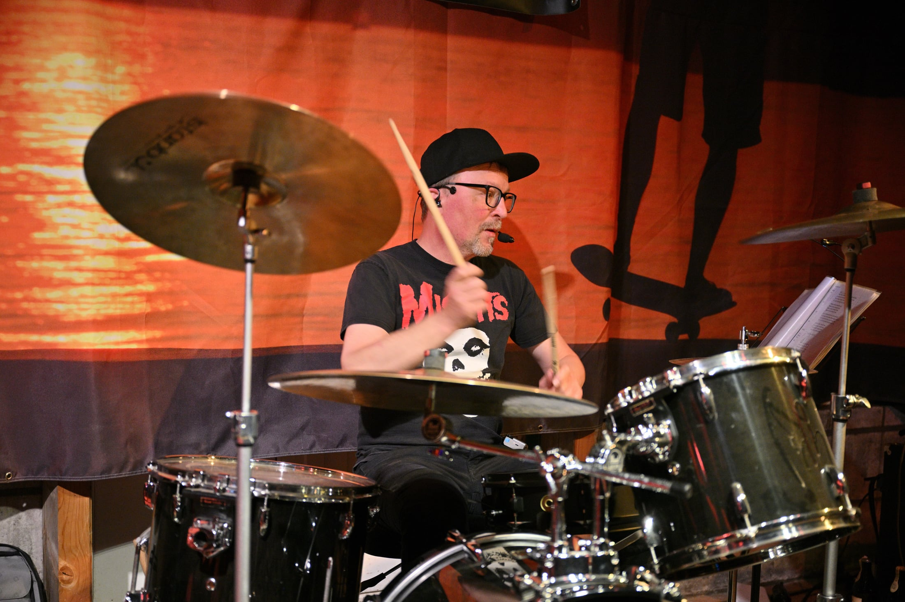

Letztes Wochenende war es soweit: Das erste von Downhill Deutschland gewertete Rennen jemals hat stattgefunden. Die Mädels und Jungs von [Outlaw Racing Southwest](https://www.instagram.com/outlaw_racing_southwest/) haben zum dritten mal ihr Event im legendären Board- und Bikepark von Großerlach organisiert.

Auf dem Gebiet des ehemaligen Skigebietes gibt es alles, was es für ein gelungenes Event braucht: Sanitäre Anlagen, einen Kiosk mit Verpflegung, ausreichend Platz zum Campen und natürlich den berühmten Schlepplift mit der kleinen aber äußerst herausfordernden Strecke.\
Bei freier Strecke kann man direkt vom Lift aus in den Run starten (oben gehts los!). In der oberen Sektion geht es direkt in eine steile Rechtskurve, direkt gefolgt von einer flacheren Linkskurve die schwierig zu Meistern ist. Im Anschluss geht es nach einer kleinen Geraden in eine rechts-links Schikane die immer enger wird und im steilsten Stück der Strecke, dem “Drop”, endet. Auf dem darauf folgenden Stück wird die höchste Geschwindigkeit erreicht und man wird in den schwierigsten und spektakulärsten Streckenabschnitt, die Party Corner katapultiert. Unter den Augen der Zuschauerinnen und Zuschauer müssen die Fahrerinnen und Fahrer an dieser Stelle eine extrem enge rechts-links Schikane bewältigen, nur die Mutigsten trauen sich das ohne vorher signifikant abzubremsen.\
Kurz darauf folgt die Ziellinie des Rennens sowie die Shutdown Zone, von der aus man theoretisch sofort wieder in den Lift rollen kann.

Hubert Czaczka airbreakt in die Party Corner. _Foto: Lukas Wünsche_

Freitagabend war Anreise. Das Event war mit 80 Teilnehmenden komplett ausgebucht, Leute kamen nicht nur aus Deutschland: Skaterinnen und Skater aus Tschechien, England, der Schweiz, den Niederlanden, Österreich und weiteren Ländern sind für eines der ersten Events der Saison angereist.\
Am Samstagfrüh wurde der Lift dann gestartet. Bis zum Mittag konnten sich alle Fahrer mit der Strecke vertraut machen und ihre Rennlinie üben.\
Leider fiel der Lift nach einigen Runden aus, was zu einer ungeplanten Pause führte. Außer ein paar Motivierten, die zum Skaten die Liftstrecke einfach hochwanderten, war es für die meisten Leute Zeit sich am Kiosk zu stärken und das extrem gute Wetter zu genießen.\

Einige Teilnehmer ließen sich den Spaß trotz des defekten Lifts nicht nehmen. _Foto: Lukas Wünsche_

Durch den engagierten Einsatz von Heiko vom Orgateam und den Liftbetreibern konnte der Lift gerade noch rechtzeitig zum Start des Rennens wieder zum Laufen gebracht werden.\
Neben der Open Class mit ganzen 60 Teilnehmerinnen und Teilnehmern gab es die Kategorien Womens und Classic Luge (Buttboard).\
Unter der Leitung von Brini und Gago von Downhill Deutschland wurden im Qualifying zunächst zwei Zeiten von allen Fahrern gemessen. Aus dem daraus resultierendem Ranking wurden dann die Brackets für das eigentliche Rennen erstellt. Aus den insgesamt 52 Ridern in der Open Class resultierte ein 32er Bracket, für Buttboard (3 Teilnehmer) wurde direkt das Finale ausgefahren. Für die 5 Teilnehmerinnen aus der Womens\* Klasse wurde das Ranking direkt aus den Qualizeiten ermittelt.\
Die genauen Zeiten und den Rennverlauf könnt ihr hier im Google Sheet nachlesen: [Link](https://docs.google.com/spreadsheets/d/1VLsfw06leP03q_vQykEBmkIqrKoYU7zP/edit#gid=117799373)

Deutscher Buttboard Meister 2024 Ulrich Becker in der ersten Schikane. _Foto: Hannes Jaa_

Auro surft in perfekter Form in den Drop. _Foto: Hannes Jaa_

Die Rennstrecke in Großerlach ist zu schmal um klassische Kopf-an-Kopf Heats zu fahren, weshalb sich die Crew von Outlaw Racing Southwest für zeitbasierte 2er Heats entschieden hat: In jedem Heat musste der schlechter qualifizierte Rider eine Zeit vorlegen, die der andere dann zu schlagen hatte. Das führt zu interessanten strategischen Überlegungen: Wie schnell war der Andere im Qualifying? Muss ich etwas riskieren oder kann ich einen konservativeren Run machen?\
Im Verlauf des Rennens wurden die Heats immer spannender, oft entschieden wenige Zehntelsekunden über das Weiterkommen in die nächste Runde.\
Im ersten Halbfinale Samuel Schuler gegen Jack Plummer wurde es dramatisch: Wissend, dass er gegen den zweimaligen Großerlach Sieger und erstqualifizierten Samu alles geben muss, versucht Jack das was sich bisher keiner getraut hat: Full Tuck, also komplett ungebremst fährt Jack in die letzte Schikane. Er hat nicht genug Grip, kommt im Rechtsknick ins Schwanken und muss seine Hand innen absetzen. Leider ist da kein Asphalt mehr übrig und er stürzt vom Brett und stürzt in die gegenüberliegende Böschung. Für ihn ist das Rennen vorbei, er hat starke Schmerzen im rechten Bein. Später stellt sich heraus, dass er sich das Wadenbein und den Knöchel gebrochen hat und operiert werden muss. Get well soon boss!

Jack Plummer aus England war einer der besten Fahrer des Rennens. Wir wünschen im eine schnellsten Genesung! _Foto: Lukas Wünsche_

Die beiden Final Runs gefilmt von Draft Train Media

Im Finale ging es nochmal heiß zur Sache: Samuel Schuler gewann zum dritten mal in Folge das Großerlach Rennen und stellte dabei auch noch eine neue Bestzeit auf. Er bleibt damit ungeschlagen und ist nach dem ersten Downhill Deutschland Rennen der Saison auf Platz 1 des nationalen Rankings. Glückwunsch Samu!\
\
Hier die Podien der einzelnen Klassen, die genauen Ergebnisse findet ihr unter [Ranking](/ranking/).\
\
Women\*:\
1\. Livia Waldburger\
2\. Marieke Wünsche\
3\. Katharina Krumm\
\
Buttboard:\
1\. Ulrich Becker\
2\. Gunnar Kalb\
3\. Rainer Österle\
\
Open:\
1\. Samuel Schuler\
2\. Alex Dehmel\
3\. Christoph Schmalz\

Podium der Open Class. _Foto: Hannes Jaa_

Nach der Preisverleihung mit dem ein oder anderen Shoey wie es die Tradition verlangt, wurde natürlich gefeiert. Bei musikalischer Unterhaltung der Skaterband Wurst Case wurde getrunken, getanzt und natürlich noch ein bisschen Techtalk betrieben.\
Wir als Downhill Deutschland können uns einfach nur bei allen bedanken: Der Orga Crew, den Mädels und Jungs vom Skilift Board- und Bikepark Großerlach und vor allem natürlich den Teilnehmerinnen und Teilnehmern. Alle Plätze waren ausgebucht, das Interesse war riesig. Und wir freuen uns schon sehr auf die zweite, finale Runde der ersten Downhill Deutschland Meisterschaft im Teutoburger Wald, das Teuto Downhill. Das ist übrigens auch schon komplett ausgebucht 🙂\
\
Wir sehen uns oben!

Wurst Case hat die Stimmung mal wieder ordentlich angeheizt. _Fotos: Hannes Jaa_
