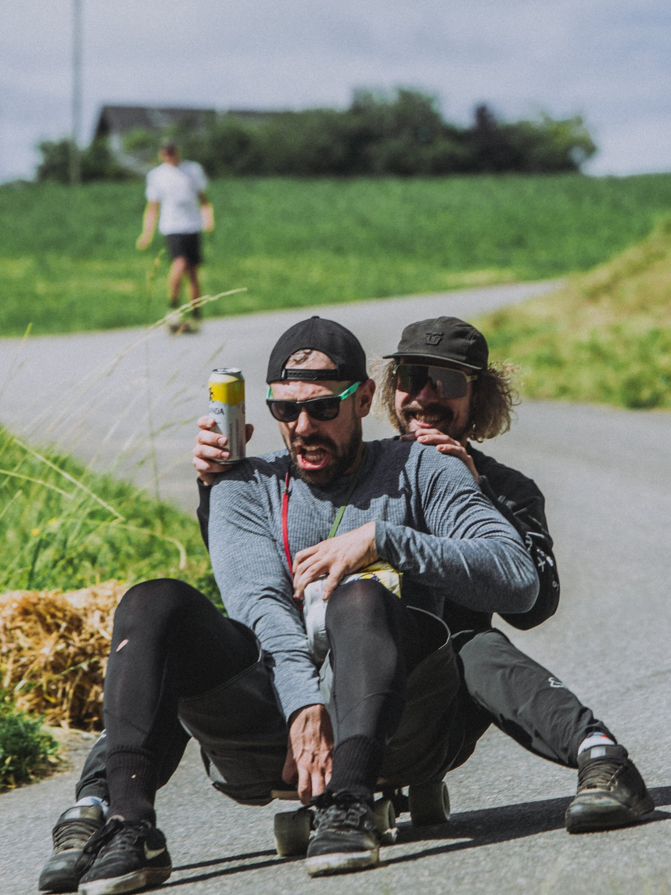
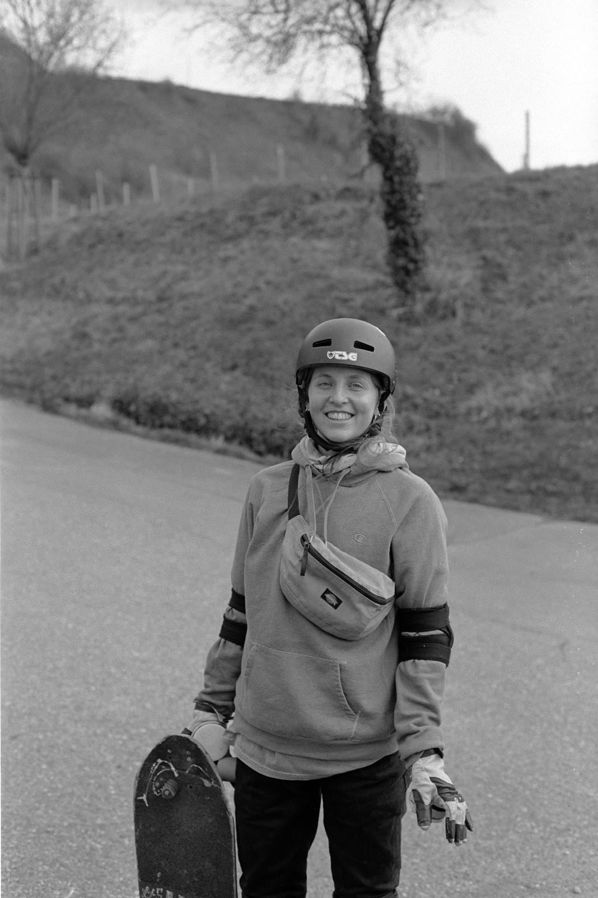
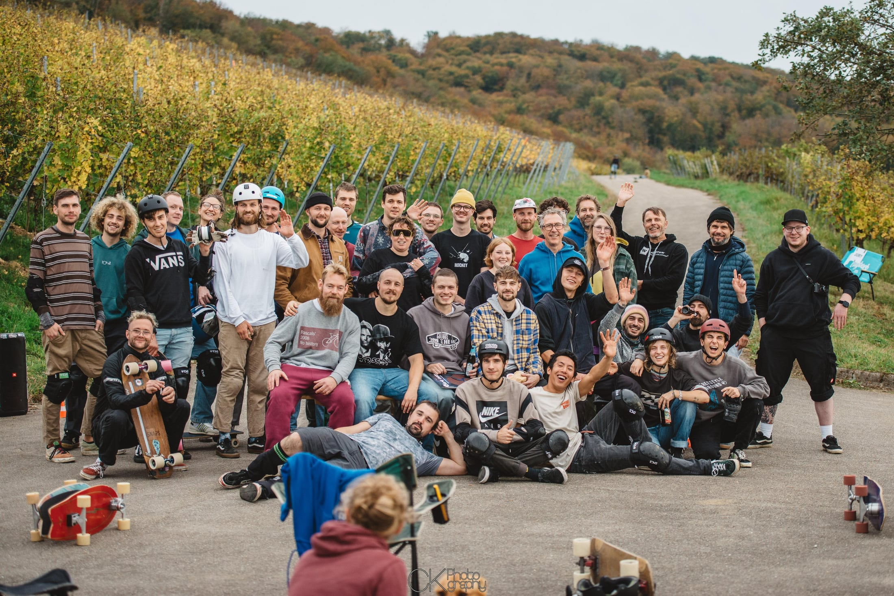

**Skater des Jahres**

Foto: @duckvaderphoto

**Samuel Schuler & Alex Dehmel**

Gleichstand!! Alex Dehmel und Samuel Schuler haben in unserer Umfrage Skater des Jahres 2024 gleich viele Stimmen erhalten – daher Gratulation an beide!

Alex ist seit etlichen Jahren nicht mehr weg zu denken aus der Downhill Community und ein wahres Urgestein. Er hat mit Sicherheit die meisten Kilometer auf dem Skateboard gemacht und nutzt jede freie Minute seiner Zeit auf dem Brett. Dafür ist er sogar in die Schweiz gezogen, um näher an den guten Strecken zu sein. Auch seine Motivation für Racing ist ungebrochen und er ist seit jeher auf vielen Podien in ganz Europa zu sehen. Wir sind uns sicher, dass uns Alex noch sehr lange erhalten bleibt und uns mit seiner ungebrochenen Euphorie noch viele weitere Jahre anstecken wird!

Samu, gute zehn Jahre jünger als Alex, hat es mit seinem unfassbaren commitment 2024 geschafft, sich den Titel des Deutschen Meisters zu holen! Als ungeschlagener Gewinner des Zeitrennens in Großerlach, sicherte er sich dort 2024 die Triple Crown – nach drei Siegen in Folge! Wer schon mal in Großerlach war kann sich vielleicht ungefähr vorstellen, was für eine krasse Leistung das ist. Auch beim Teutodownhill zeigte er sein enormes Potential und gewann, auf den letzten Zentimetern mit einem der knappsten Überholmanöver der letzten Saison, das Rennen und somit die Deutsche Meisterschaft 2024. Wir sind gespannt was Samu die kommenden Jahre im petto hat und freuen uns auf viele weitere verrückte Aktionen und gemeinsame Skatesessions mit ihm!

**Newcomerin des Jahres**

Foto: Konstantin Thomas

**Pauline Zahn**

Pauline sichert sich in unserer Community Umfrage den Titel der Newcomerin des Jahres 2024!

Seit 2023 auf dem Downhill Skateboard unterwegs begeistert sie die Downhill Community mit ihrer unglaublichen Lernkurve. Beheimatet und aktiv in der Freiburg Freeride Crew, lernte sie dort ihre ersten Slides und verbringt seither viel ihrer freien Zeit auf dem Brett. Als sie 2024 zum ersten Mal größere, internationale Events besucht wird schnell klar, wie viel Talent und Motivation Pauline mitbringt. Da werden auf dem KnK, dem größten Freeride Event Europas, schon direkt mal ein paar Standup Slides rausgehauen. Danke für deine positive Energie die du ausstrahlst und dafür, dass du durch deine Art auch andere (junge) Frauen motivierst!

**Event des Jahres**

**Teutodownhill**

Die Kobolde (Longboard Münsterland e.V.) und ihre Crew haben es geschafft, die Community mit ihrem Teutodownhill so dermaßen zu begeistern, dass sie es in unserer Umfrage auf Platz 1 des Events des Jahres 2024 (europaweit) geschafft haben!

2023 mit einem ersten Testlauf gestartet, war das Teuto 2024 das erste Mal Teil der Deutschen Meisterschaft. Sie haben ein unglaublich rundes Event auf die Beine gestellt – mit ordentlicher Streckensicherung, vielen Runs, leckerer Verpflegung und herausragender Kommunikation. Die Kobolde haben ihren Laden einfach im Griff.

Hart gefeiert wurde natürlich dann auch noch, so wie es sich für ein Kobold Event gehört. Dafür sagen wir vielen Dank und freuen uns jetzt schon auf die nächste Sause in diesem Jahr in Borgholzhausen! Save the date: 05.-07.09.2025!

**Video des Jahres**

Für das Video des Jahres 2024 wurde nicht nur ein einzelnes Video, sondern gleich die ganze Gang „Professional Kidz“ gewählt! Eure liebsten Videos sind die aus der „Ups&Downs“-Serie.

Überzeugt euch selbst und checkt den [Youtube Kanal](https://www.youtube.com/@professionalkidz) aus:

**Community-Arbeit**

Der Award für die beste Community Arbeit 2024 geht an die Freiburg Freeride Crew!

Die größte und wahrscheinlich auch aktivste Downhill Community in Deutschland besticht nicht nur durch zahlreiche Skatesessions, teilweise mehrmals die Woche, sondern auch durch gut organisierte Slidejams und Outlaw Races für die gesamte deutsche Community. Samuel Schirra konnte mit seinem Engagement viele neue Leute für das Downhill Skaten begeistern und trägt dadurch maßgeblich zum Zuwachs/Erhalt unseres Sports bei. Gemeinsame Ausflüge für alle skill levels und die Ausstattung von Nachwuchs mit Equipment gehören in Freiburg zur Tagesordnung.

Ein riesen Danke an die Freiburg Freeride Crew von der ganzen, deutschen Community für euren Einsatz! Wir freuen uns auch in diesem Jahr auf viele, tolle Sessions in den sonnigen Freiburger Weinbergen!
