Von 17.-21. September 2024 fand die Weltmeisterschaft Downhill Skateboarding und Streetluge im Rahmen der 3. World Skate Games in Tortoreto, Italien statt. Organisiert von World Skate, werden bei den World Skate Games die Weltmeisterschaften nahezu aller Rollsportarten ausgetragen. Die Spiele fanden über den gesamten Monat September, verteilt über mehrere Orte in Italien statt. Die kleine, idyllische Altstadt Tortoreto in den Abruzzen, gelegen auf einem Berg mit atemberaubender Aussicht auf das Meer, war der Austragungsort für die Downhill Sportarten Skateboarding, Streetluge und Inline. Mit insgesamt 304 angemeldeten Athlet\*innen und 55 nationalen Offiziellen aus 35 Nationen war diese Weltmeisterschaft die bis dato größte im Downhill Sport. Für Skateboarding und Streetluge waren 127 Skateboard Männer, 38 (!!) Skateboard Frauen, 37 Streetluge Männer und 13 Streetluge Frauen angemeldet, um für die WM-Titel im Zeitfahren und im Rennen zu kämpfen.

Unser deutsches Nationalteam, mit seinen 15 Vertreter\*innen, sah wie folgt aus:

Teammanagerin: Brini Luci

Trainer: Gerrit Geiger, Lukas Wünsche

Skateboard Männer: Alex Dehmel, Chris Schmalz, Leif Schloßarek, Samu Schuler, Max Deutsch

Skateboard Frauen: Marieke Wünsche

Streetluge Männer: Uli Becker, Martin Witzigmann, Rainer Oesterle, Gunnar Kalb

Streetluge Frauen: Jenny Kampa, Gritt Brosch

Nachdem wir alle 1-2 Tage vorher angereist waren, um die Gegend zu erkunden, rauszufinden wo es den nächstgelegenen Kaffee gibt und wo man sich die beste Pizza und Pasta einverleibt, schenkten wir natürlich auch der Strecke unser besonderes Interesse. So versammelten wir uns am Montag, einen Tag vor Beginn des Events, an der Startlinie, um gemeinsam einen „Track-walk“ zu machen. Bei der 1,3 km langen Strecke kam es vor allem darauf an, die perfekte Linie zu finden, die Sweeper und Knicke möglichst gut durch zu tucken und den geeigneten Ort für ein Überholmanöver zu finden. Als Knackpunkt erwies sich auch die erste Rechtskurve, welches die einzige Kurve war die man sliden musste. Da die Strecke nicht all zu schnell war (Topspeed knapp 80 km/h) und sich das Feld kaum auseinanderreißen würde, war es besonders wichtig taktisch vorzugehen und seine eigenen Stärken und Schwächen einschätzen zu können.

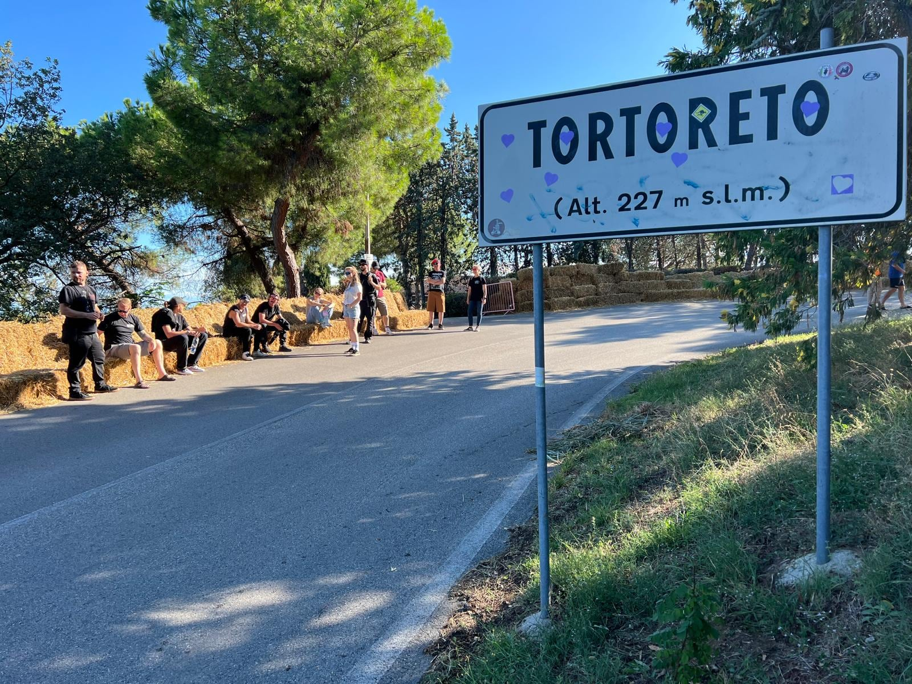

Track-Walk

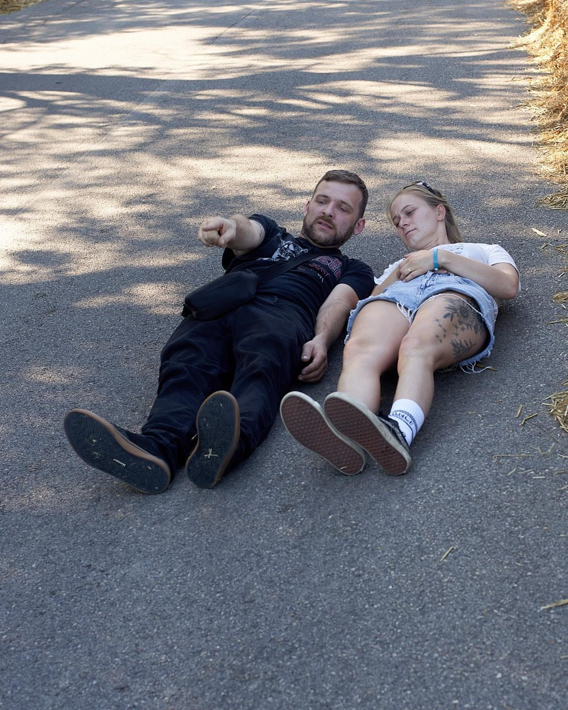

Wuchti und Jenny beim Liniencoaching

Am ersten Tag des Events sollte am Vormittag das Training für alle Skateboarder\*innen und am Nachmittag für die Streetluger\*innen stattfinden. Leider hatte es schon am Morgen angefangen aus Eimern zu schütten, weshalb das Training für die Skateboarder\*innen letztendlich gestrichen wurde. Auch die Streetluger\*innen konnten am Nachmittag nur einige wenige Runs machen, da die Strecke bei diesen Verhältnissen kaum zu skaten war. So hofften wir auf Trainingstag 2, der zwar am Vormittag auch nochmal nass war, aber im Laufe des Tages trockener wurde und alle die Chance bekamen, die Strecke zu testen. An den folgenden beiden Tagen stand das Zeitfahren auf dem Programm, das glücklicherweise bei perfektem Wetter stattfinden konnte.

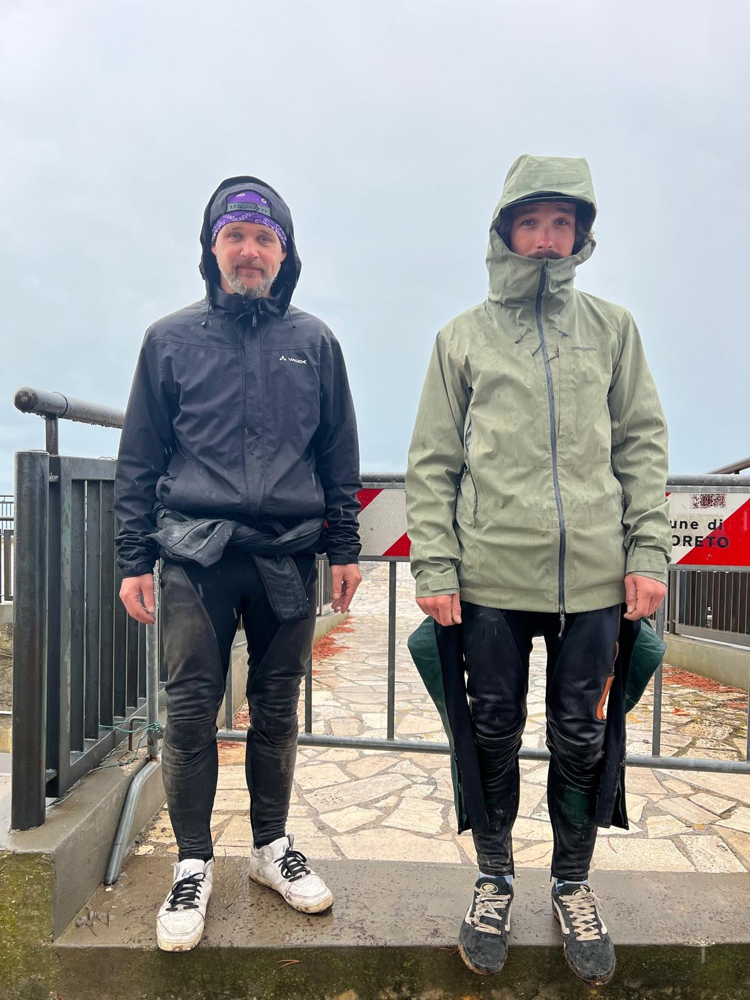

Chris und Samu am Regentag bevor das Training gecancelt wurde

Das Zeitfahren erfolgt nach einem besonderen System: Alle Fahrer\*innen fahren ihre erste Zeit (Q1A) und haben dann nochmal die Chance in Q1B diese Zeit zu verbessern. In die nächste Runde (Q2) kommen nur die besten 50% aus Q1A/B, was bei diesem unglaublich starken Feld aus Fahrer\*innen schon die erste Hürde war, die es zu meistern galt. In Q2 musste man es dann schaffen, in die Top 10 zu fahren, denn nur diese kamen schlussendlich in Q3, um die finalen Platzierungen auszufahren. Dabei wird in jeder Runde die Uhr wieder auf „0“ gestellt, d.h. jeder Run muss sitzen und man kann sich nicht auf einer gut gefahrenen Zeit „ausruhen“, wie es sonst der Fall ist. Das Level aller Skatenden war einfach überragend, was sich auch in den Zeiten widerspiegelte. Bei den Skateboard Männern waren die Top 10 alle innerhalb einer Sekunde!

Als beste\*r Deutsche\*r schafften es im Zeitfahren Chris Schmalz auf Platz 20 (Skateboard Männer), Marieke Wünsche auf Platz 10 (Skateboard Frauen), Uli Becker auf Platz 5 (Streetluge Männer) und Jenny Kampa auf Platz 10 (Streetluge Frauen). STARK!

Alle Ergebnisse der Time Trials:

[Skateboarding Men – Time trials](/wp-content/uploads/2025/02/Skateboarding-Men-Time-trials-1.pdf)

[Skateboarding Women – Time trials](/wp-content/uploads/2025/02/Skateboarding-Women-Time-trials.pdf)

[Streetluge Men – Time trials](/wp-content/uploads/2025/02/Streetluge-Men-Time-trials.pdf)

[Streetluge Women – Time trials](/wp-content/uploads/2025/02/Streetluge-Women-Time-trials.pdf)

Anhand dieser Zeiten, die als Qualifikation für das Rennen galten, wurden für das K.O-System die Heats erstellt. Besonders war, dass bei den Skateboard Männern in einem 64er-Bracket gestartet wurde, was bedeutete, dass nur ca. 50% der insgesamt 111 tatsächlich teilnehmenden Athleten am eigentlichen Rennen mitfahren durften. Alle, die in Q1A/B eine Zeit in der unteren Hälfte gefahren haben, waren nicht für das Rennen qualifiziert. Die anderen Kategorien wurden im 32er- bzw. im 16er-Bracket ausgefahren, sodass in diesen alle Fahrer\*innen die Möglichkeit hatten am Rennen teilzunehmen.

Am Renntag ging es dann heiß her. Das galt nicht nur für das Wetter, sondern auch für die Gemüter. Die erste Runde überstehen war die erste Herausforderung des Tages. Nach ein paar Warmup-Runs ging es dann auch schon zur Sache. Durch den Livestream von World Skate konnte man das Rennen vom Start bis zum Ziel mitverfolgen, auch der Kommentator Adam Westfall (USA) hat einen super Job gemacht für alle, die das Rennen von Zuhause aus mitverfolgt haben. Interviews wurden gegeben, Drohnen geflogen und Beifall geklatscht von den vielen Zuschauenden vor Ort. Der Vibe war einfach mega!

Den Livestream könnt ihr euch auf www.worldskate.tv anschauen.

Unsere Teammanagerin Brini, die als Ansprechpartnerin für alle Belangen bezüglich des Teams und der Athlet\*innen vor Ort war, hatte dann auch noch alle Hände voll zu tun, als unser Fahrer Leif in der ersten Runde des Rennens gefoult wurde, sich dabei verletzte und dadurch nicht mehr am Rennen teilnehmen konnte. Dies führte zu einer Disqualifikation des verursachenden Fahrers, was in eine schier endlose Diskussion mit diesem mündete. Aber abgesehen von diesem einen Fahrer war der Umgang unter den Athlet\*innen absolut sportlich, fair und rücksichtsvoll.

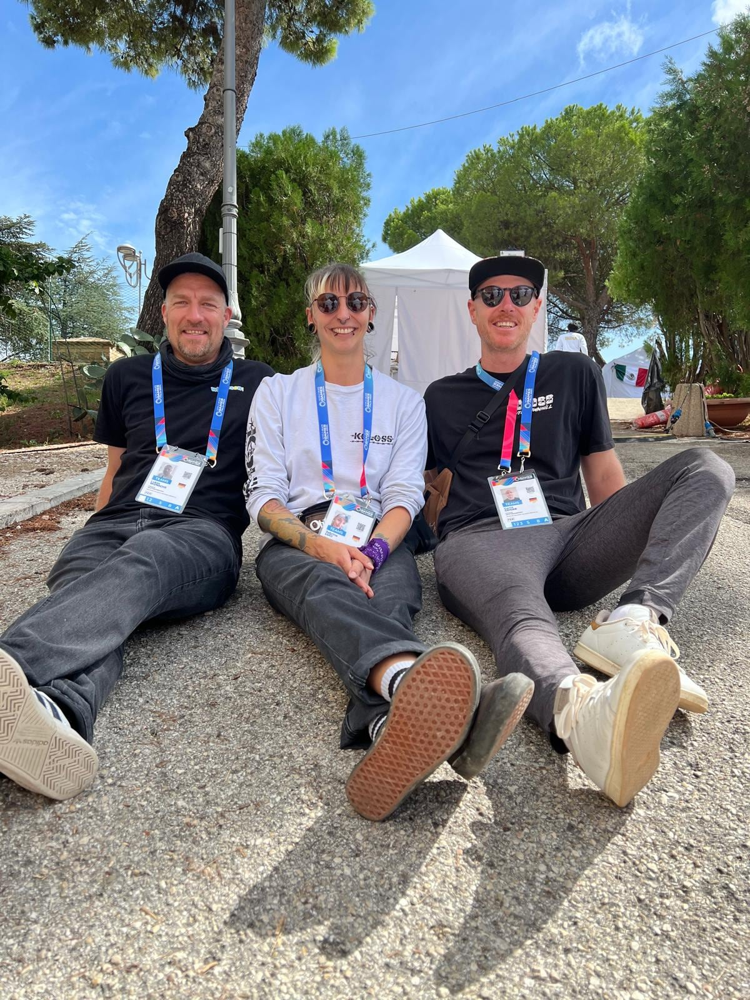

Die Nationalen Offiziellen Luksen, Brini und Gago

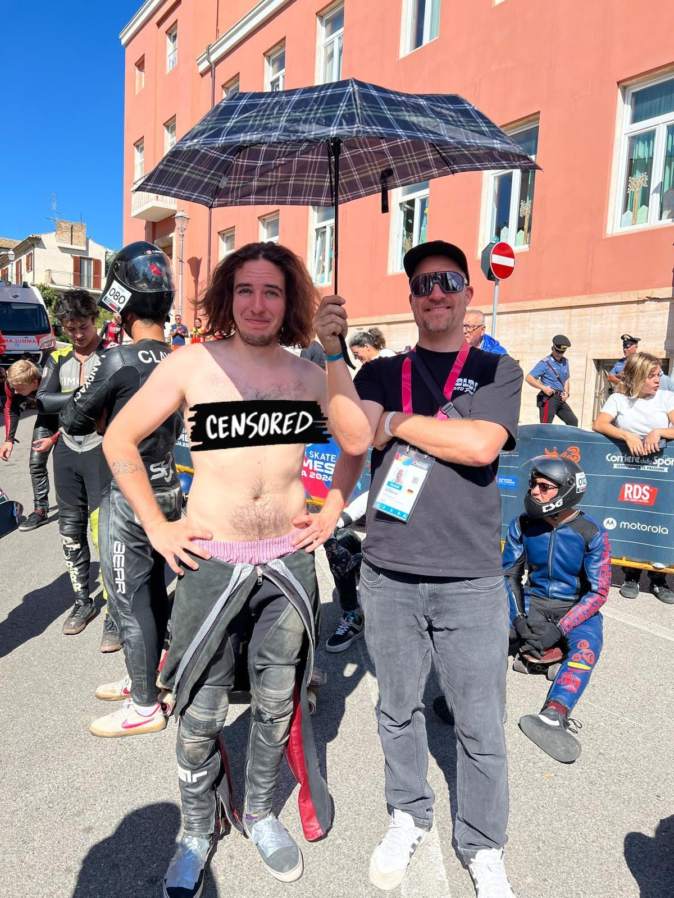

Coach Luksen doing Coachthings..

Als beste\*r Deutsche\*r schafften es im Rennen Chris Schmalz auf Platz 26, Marieke Wünsche auf Platz 7, Uli Becker auf Platz 5 und Jenny Kampa auf Platz 8! Insgesamt eine mega starke Leistung von unserem gesamten Team!

Alle Ergebnisse des Rennens:

[Skateboarding Men – Race results](/wp-content/uploads/2025/02/Skateboarding-Men-Race-results.pdf)

[Skateboarding Women – Race results](/wp-content/uploads/2025/02/Skateboarding-Women-Race-results.pdf)

[Streetluge Men – Race results](/wp-content/uploads/2025/02/Streetluge-Men-Race-results.pdf)

[Streetluge Women – Race results](/wp-content/uploads/2025/02/Streetluge-Women-Race-results.pdf)

Am Abend, nach der Sieger\*innenehrung gab es dann noch eine spontan organisierte Straßenparty in Tortoreto, bei der wir uns alle gegenseitig abgefeiert haben 😊 Die Downhill-Community ist einfach unschlagbar!

An der Stelle ein riesen Danke an unsere Trainer Gago und Luksen für ihren Einsatz – und an das gesamte Team Germany. Es war einfach ein Fest mit euch! Ich glaube, ich spreche für alle, wenn ich sage, dass dieses Event das krasseste Skateevent war, das wir alle je besucht haben. Danke an World Skate für dieses professionelle Setup – es ist sehr schön zu sehen in welche Richtung sich unser Sport entwickelt und wie hoch das Level aller Teilnehmenden war! Insgesamt eine unbeschreibliche Erfahrung, die uns allen sicherlich ewig in Erinnerung bleibt.

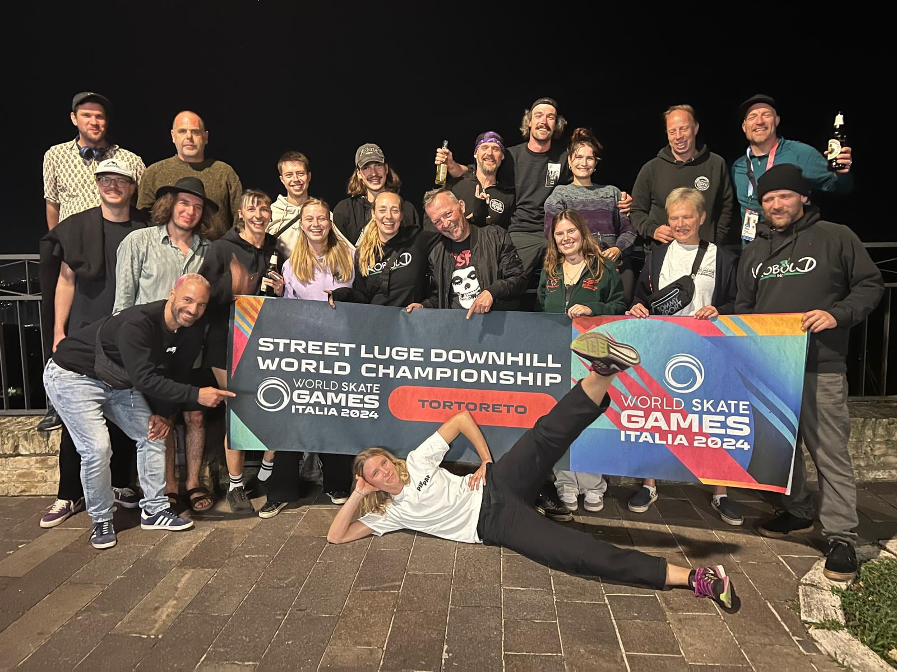

Großteil von Team Germany und Switzerland mit der Weltmeisterin Selina Theiler aus der Schweiz!

Die folgenden Skatebilder sind alle von Nils Kampa. Danke für deinen Einsatz und die geilen Shots!

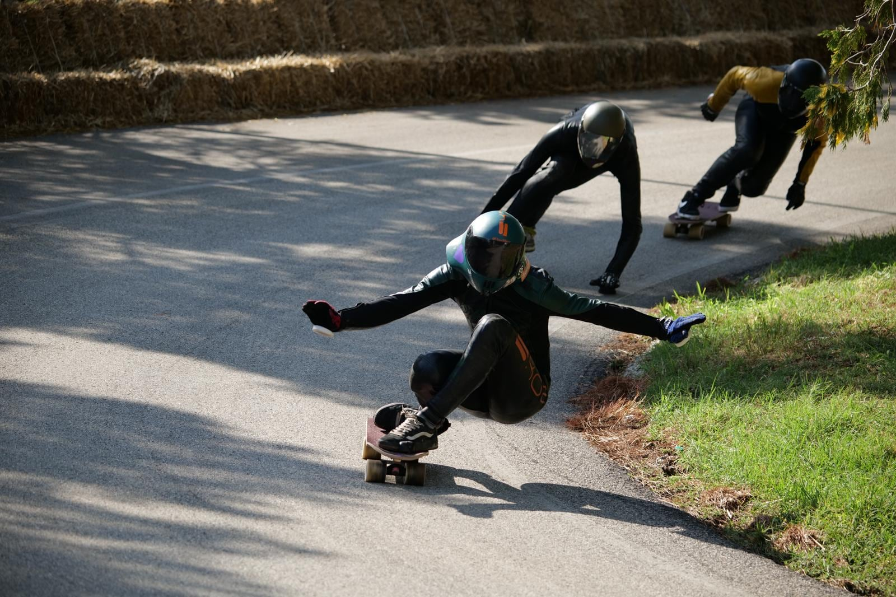

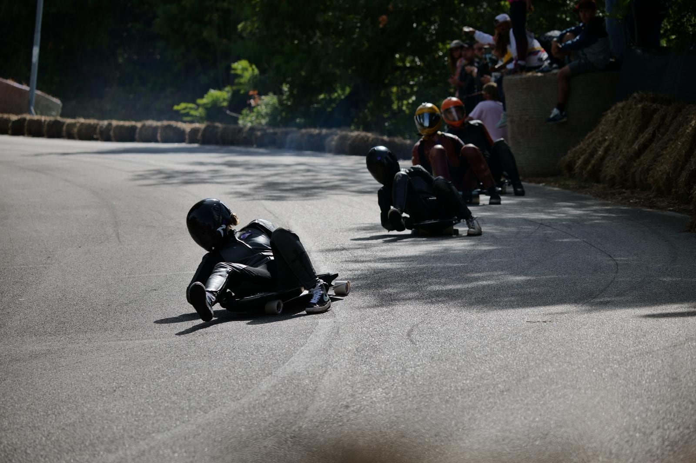

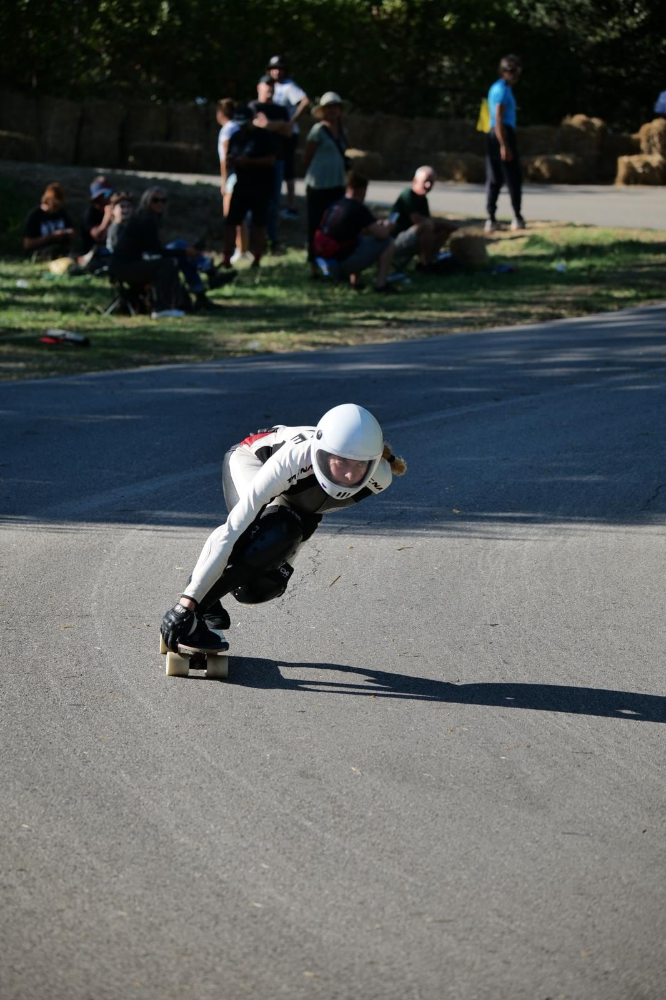

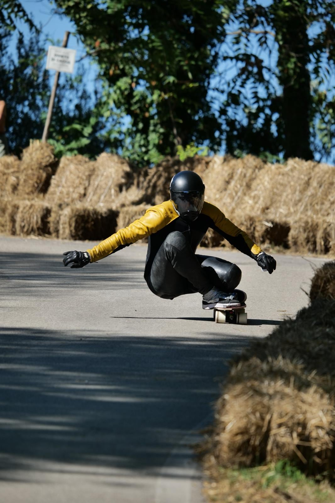

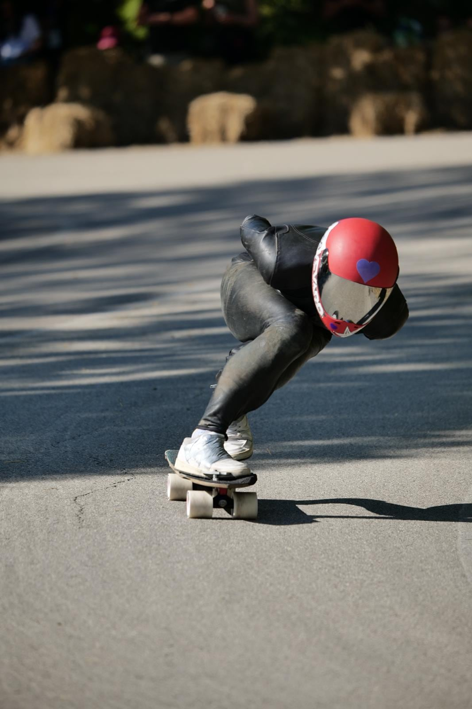

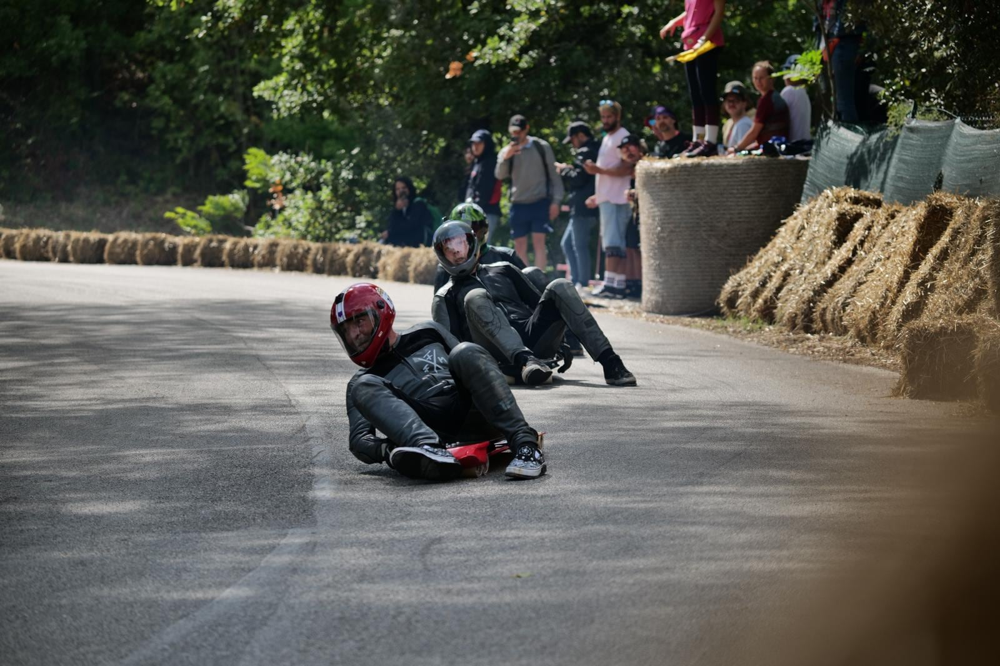

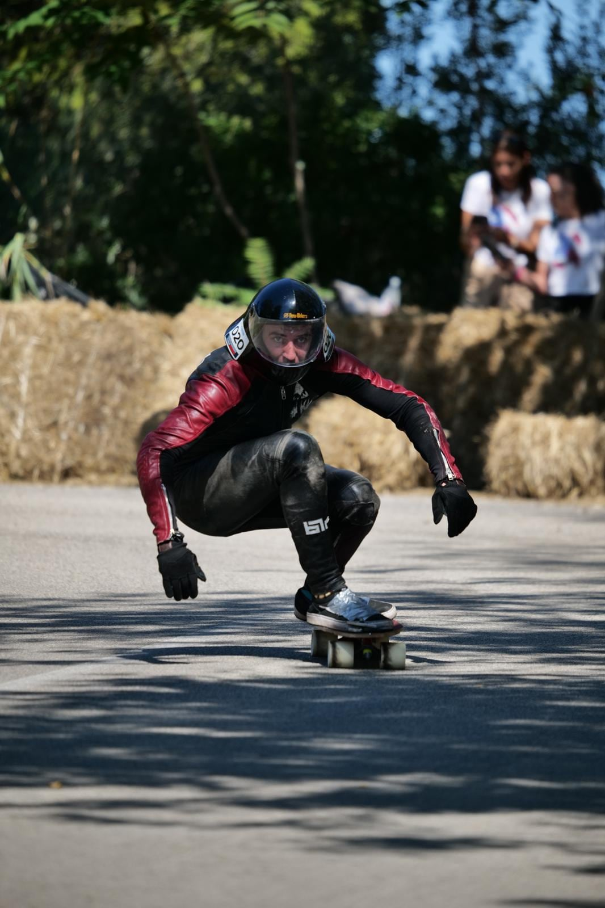

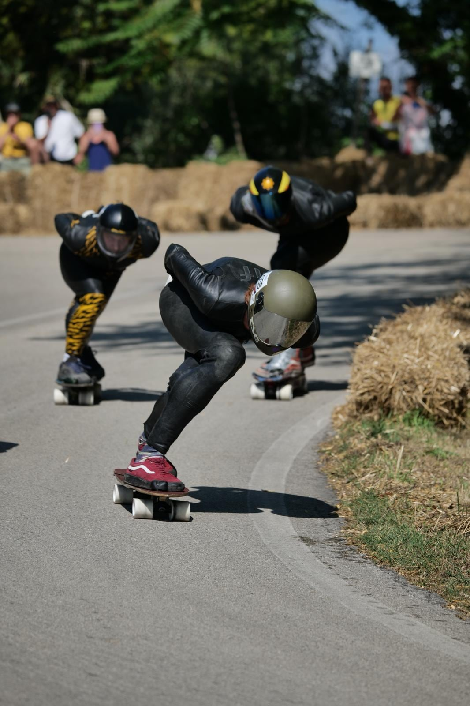

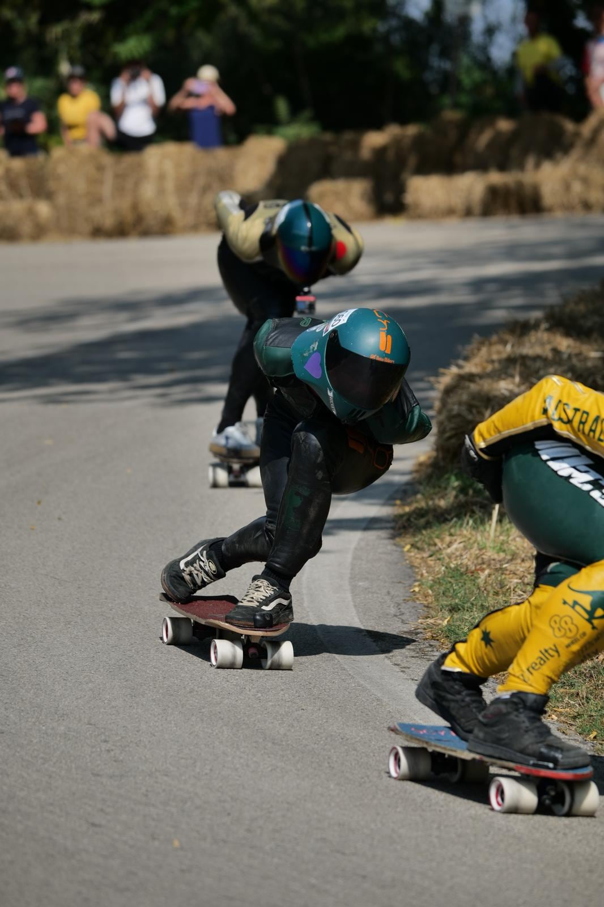
